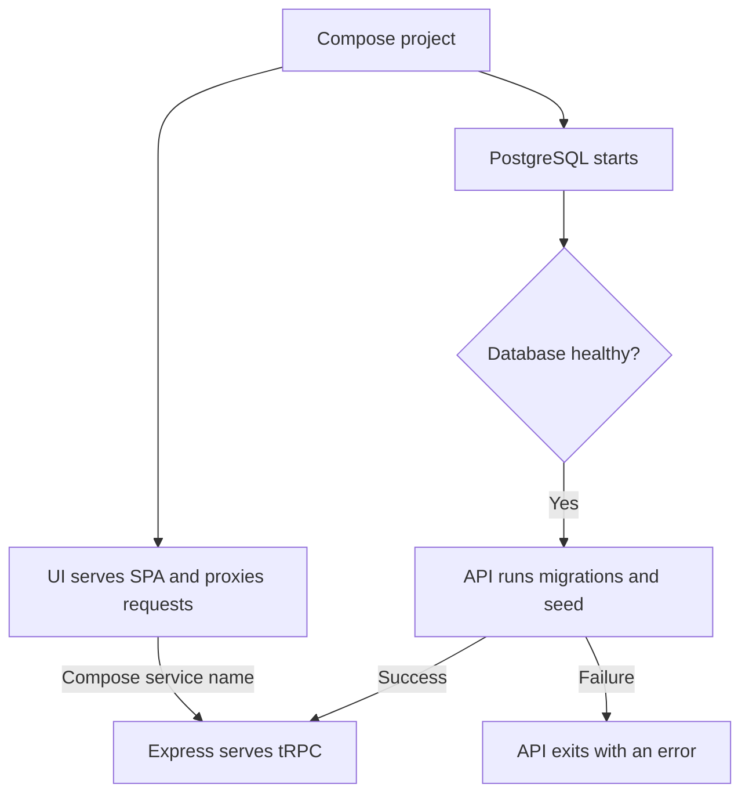
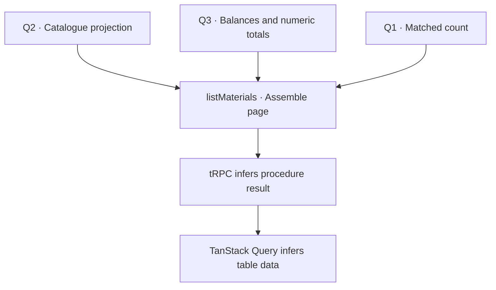
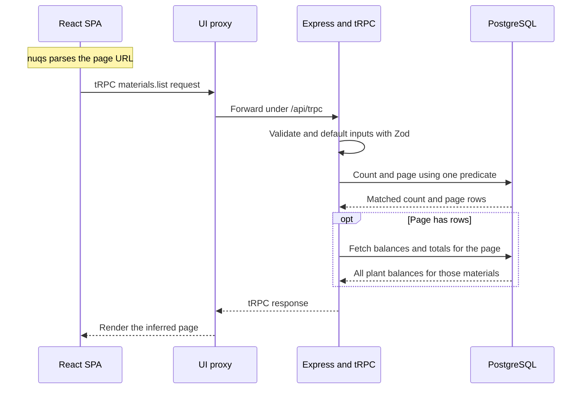

# Material Register API and implementation plan

**Lexin AI Assessment · The Pragmatist**  
**Status:** Design agreed. Application code, images and Compose configuration are pending implementation.  

Implement the register with Express-hosted tRPC, Zod input validation and Drizzle-inferred results. Use two core procedures, `materials.list` for the table and `plants.list` for the plant filter. The plan builds on the existing PostgreSQL schema, three-query list design and three-container architecture.

## Repository structure and responsibilities

```text
root/
  src/
    ui/
      index.html
      main.tsx
      trpc/client.tsx
      features/materials/
        url-state.ts
        MaterialTable.tsx
    shared/
      material-values.ts
      materials-list-input.ts
    db/
      schema.ts
      client.ts
      drizzle.config.ts
      migrations/
      seed.ts
      queries/
        material-where.ts
        materials.ts
        plants.ts
    api/
      server.ts
      trpc/
        trpc.ts
        router.ts
        routers/
          materials.ts
          plants.ts
  test/
  docker/
    Dockerfile.ui
    Dockerfile.db
    Dockerfile.api
    compose-db.yml
    compose-api.yml
    compose-ui.yml
  .github/
  scripts/
    compose.sh
  package.json
  package-lock.json
  README.md
```

| Location | Responsibility |
| --- | --- |
| `src/ui/` | React Router SPA, grouped nuqs URL state, typed tRPC client and TanStack Query, Mantine controls and table. |
| `src/shared/` | Material type and status tuples, sort keys and list defaults in a browser-safe module. A separate module defines the Zod list input and exports its parsed TypeScript type. |
| `src/db/` | Drizzle tables, connection, migrations, seed and queries. Query code uses the parsed input type from `shared/` and owns the projected fields and stock assembly. |
| `src/api/` | Express host, tRPC setup, procedure registration, input validation and shared error handling. Exports `AppRouter` from `src/api/trpc/router.ts`. |
| `test/`, `.github/`, `scripts/` | Automated tests if included, GitHub workflow files if used, and repeatable project commands, respectively. |

Use a single root package and npm lockfile. The API and UI have separate build entry points and TypeScript checks. Point Vite at `src/ui/`. Both build environments install the dependencies needed to resolve server types. The UI uses `import type { AppRouter }` and imports only browser-safe constants at runtime. This layout replaces the illustrative `api/src/db/` and `web/src/` paths in earlier plans.

## Stack and deployment

| Service | Docker files | What runs there |
| --- | --- | --- |
| `ui` | `Dockerfile.ui`, `compose-ui.yml` | A build stage produces the Vite assets. The final image serves them, uses the SPA fallback for client routes, and proxies `/api/trpc` to `api` with the procedure path and query string preserved. Only this service publishes a host port. |
| `api` | `Dockerfile.api`, `compose-api.yml` | Node runs Express and tRPC using `src/api/`, `src/db/` and `src/shared/`. The image includes the migration files and the tooling or compiled entry points needed to migrate and seed. Express listens on the container network. |
| `db` | `Dockerfile.db`, `compose-db.yml` | A pinned official PostgreSQL base image, a named data volume and a readiness check using `pg_isready`. Drizzle runs from the API service. |



Load the three YAML files into one Compose project, with `docker/compose-db.yml` first. Set the project name there to `material-register`. In each service's build configuration, use context `..` relative to the first Compose file and set `dockerfile` to its `docker/Dockerfile.*` path relative to the build context. The root context gives the API access to shared and database modules and gives the UI build access to the router types. Use the Compose service names `api` and `db` for internal traffic. [Compose file merging](https://docs.docker.com/compose/how-tos/multiple-compose-files/merge/) · [Compose build configuration](https://docs.docker.com/reference/compose-file/build/) · [Compose networking](https://docs.docker.com/compose/how-tos/networking/)

Make `scripts/compose.sh` resolve the repository root and forward arguments to `docker compose` with all three `-f` options. The planned reviewer commands are `./scripts/compose.sh config` to inspect the merged configuration and `./scripts/compose.sh up --build` to start the app. Gate API startup on the database health check, then apply migrations, run the deterministic, repeatable seed and start Express. Keep the PostgreSQL connection settings in the server-side environment. The UI can show a query error if the API is temporarily unavailable. [Compose startup order](https://docs.docker.com/compose/how-tos/startup-order/)

## Procedure contracts and scope

| Procedure | Input | Result |
| --- | --- | --- |
| `materials.list` | Zod-validated list parameters | `{ rows, total, page, pageSize }`, with enriched material rows and a count of all matches |
| `plants.list` | None | Array of `{ plantCode, name, city, state }`, ordered by name and then code |
| `materials.byNumber` | Material number | Optional detail query for the selected material |
| `materials.update` | Material number and validated partial changes | Optional edit mutation, considered as part of the detail-view extra |

The plant lookup includes all configured plants. The dropdown can display a label such as `4000 · Brisbane` and sends the stable text code. The assessment allows one optional extra if time permits. Detail and editing are part of that optional view.

### API error handling

Use tRPC as the single error boundary for API procedures. The core reads validate input and return data directly. Unexpected exceptions propagate from the database through the procedure to tRPC. For a known API failure, throw a `TRPCError` at the point where the failure is detected, such as `NOT_FOUND` if the optional detail or update operation cannot find the material. tRPC turns Zod input failures into `BAD_REQUEST`. A list with zero matches, including an unknown plant code or a page past the end, is a successful response with the applicable count. [tRPC error handling](https://trpc.io/docs/server/error-handling) · [tRPC validators](https://trpc.io/docs/server/validators)

Configure the Express adapter's `onError` once to log unexpected failures server-side with the procedure path and original cause. Configure the router's `errorFormatter` once to replace the client message for `INTERNAL_SERVER_ERROR` with a generic message and omit the stack from the response. These hooks share one tRPC boundary. The frontend handles failures through TanStack Query's error state and treats empty results separately. [tRPC error handling](https://trpc.io/docs/server/error-handling) · [tRPC error formatting](https://trpc.io/docs/server/error-formatting) · [TanStack Query overview](https://tanstack.com/query/latest/docs/framework/react/overview)

### List request

| Input | Rule | Default |
| --- | --- | --- |
| `search` | Trimmed text up to 200 characters. Matches material number, description or manufacturer part number, case-insensitively. Escape literal SQL pattern characters. | Omitted or blank applies no text predicate |
| `status` | `Active`, `Pending Review` or `Obsolete` | All statuses |
| `materialType` | `Spare Part`, `Consumable`, `Raw Material` or `Tool` | All types |
| `plantCode` | Nonempty, trimmed text code. **In stock at** means the matching plant balance is greater than zero. An unknown code returns zero matches. | All plants |
| `sortBy` | `materialNumber` or `updatedAt` | `updatedAt` |
| `sortDirection` | `asc` or `desc` | `desc` |
| `page` | Positive integer, starting at 1 | `1` |
| `pageSize` | Integer between 1 and 100 | `25` |

Use a strict Zod object and reject invalid requests before SQL executes. Reuse the same enum tuples in Drizzle's `pgEnum`, Zod and the nuqs literal parsers. Use `z.output<typeof listMaterialsInputSchema>` in the DB query because Zod has already applied defaults. Matches across the three search fields form one OR group. Each active filter combines with that group using AND. Manufacturer-name filtering remains deferred. [Zod schemas](https://zod.dev/api) · [tRPC validators](https://trpc.io/docs/server/validators) · [Drizzle PostgreSQL column types](https://orm.drizzle.team/docs/column-types) · [nuqs built-in parsers](https://nuqs.dev/docs/parsers/built-in)

### List result and type inference

| Result | Fields and behaviour |
| --- | --- |
| Material catalogue fields | `materialNumber`, `description`, `materialType`, `status`, `manufacturerName`, `manufacturerPartNumber`, `unitOfMeasure`, `unitPriceAud`, `updatedAt`. Manufacturer fields and price can be null. |
| Stock | `totalQuantityOnHand` is an exact decimal string. `plantBalances` includes `plantCode`, `plantName`, `city`, `state`, `quantityOnHand`. Include zero balances. Materials without balance records return `"0"` and `[]`. |
| Pagination | `total` counts all matches. `page` and `pageSize` echo the validated values. A page past the end returns empty rows and the correct `total`. |
| JSON transport | Quantities and prices remain decimal strings. Drizzle reads `updatedAt` as a `Date` on the server. Standard JSON carries it as an ISO timestamp string to the browser. |

Build one predicate for **Q1** (matched material count) and **Q2** (material page). Use a correlated `EXISTS` predicate for **In stock at** so multiple plant balances cannot duplicate a material. Sort by the requested field and direction, using `materialNumber ASC` to resolve timestamp ties. **Q3** runs for a nonempty Q2 page and loads all plant balances for those material numbers, including balances at other plants when the request has an **In stock at** filter. PostgreSQL calculates the windowed sum. Decode that expression to a string with `.mapWith(String)` under the selected driver mapping and verify that decimal values survive the round trip. Group by material number, remove repeated grouping and total fields from the nested balances, and preserve Q2 order. [Drizzle filters](https://orm.drizzle.team/docs/operators) · [PostgreSQL `EXISTS`](https://www.postgresql.org/docs/current/functions-subquery.html#FUNCTIONS-SUBQUERY-EXISTS) · [Pattern matching](https://www.postgresql.org/docs/current/functions-matching.html) · [Window functions](https://www.postgresql.org/docs/current/tutorial-window.html) · [Limit and offset](https://www.postgresql.org/docs/current/queries-limit.html)



Approach A uses explicit Drizzle projections and the inferred return type of `listMaterials()`. The tRPC procedures return the query results, so TypeScript propagates the selected fields, enum unions and nullability. Components can infer types from query options or derive a named type from `inferRouterOutputs<AppRouter>`. Use Zod for procedure inputs, with no separate response DTO or output validator for the core reads. [Drizzle SELECT](https://orm.drizzle.team/docs/select) · [Drizzle SQL expressions and decoders](https://orm.drizzle.team/docs/sql) · [tRPC client type inference](https://trpc.io/docs/client/vanilla/infer-types)

The companion typing plan records the type ownership, transport representations and checks for schema changes. [Material Register typing plan](./api-typing-plan.md)

## How a table request works



- Mount the standard Express tRPC adapter at `/api/trpc`. Use the tRPC TanStack Query integration and call `trpc.materials.list.queryOptions(input)` and `trpc.plants.list.queryOptions()` with `useQuery`. [Express adapter](https://trpc.io/docs/server/adapters/express) · [tRPC TanStack Query setup](https://trpc.io/docs/client/tanstack-react-query/setup) · [Typed query options](https://trpc.io/docs/client/tanstack-react-query/usage)
- A shared browser URL such as `/materials?search=bearing&status=Active&page=2` restores the view. nuqs reads typed values, the UI omits unset filters from the procedure input, and the tRPC client encodes that input using its HTTP protocol. Keep page size fixed at 25 in the initial UI. [nuqs React Router adapter](https://nuqs.dev/docs/adapters) · [tRPC HTTP protocol](https://trpc.io/docs/rpc)
- Group URL updates so that a search, filter or sort change resets the page in the same update. Clearing the filters also resets the page. Debounce the search value used for fetching and pause list requests while it settles, so resetting the page cannot send a request with the previous search. Render loading, empty and error states. [nuqs grouped updates](https://nuqs.dev/docs/batching) · [Mantine debounce hook](https://mantine.dev/hooks/use-debounced-value/)

## Implementation order

1. **Scaffold the layout and builds.** Create the two application entry points under `src/`, the root package and lockfile, and the three Docker and Compose pairs. Check that Compose resolves each Dockerfile and exposes the frontend port.
2. **Implement the shared values and database boot.** Define the enums, tables and Zod list input. Generate and review the migration. Seed at least 5,000 realistic, distinct materials, with repeatable keys and a transactional seed.
3. **Implement the core queries and procedures.** Add `buildMaterialWhere()`, the Q1/Q2/Q3 list operation and the plant lookup. Mount the router in Express, configure the shared error boundary and exercise successful, invalid and unexpectedly failed requests through the HTTP adapter.
4. **Wire the SPA.** Set up the providers, grouped URL state, debounce, Mantine filters, sort controls, pages and expandable balances. Confirm direct URL reloads through the UI container and check that the frontend runtime bundle contains no server or database modules.
5. **Run the reviewer walkthrough.** Start from a fresh volume using the README. Check the scenarios below and rehearse the live addition of a filter or a visible field. A new filter touches the Zod schema, predicate, URL parser and UI control. A visible database field flows from the explicit projection to the table through inference.

## Verification checklist

| Check | Expected result |
| --- | --- |
| Fresh and repeat startup | All three services start. Migrations run before the seed. A fresh volume has at least 5,000 distinct materials. Restarting retains rows and repeat seeding leaves counts stable. |
| Combined search and filters | Case-insensitive matches across all three search columns combine with status, material type and plant. Wildcard characters in typed search are treated literally. |
| Invalid inputs | Unknown keys, enum values, sort keys and invalid page values produce a tRPC bad-request response before SQL runs. |
| Unexpected API failure | A database or query failure reaches the shared handler with its cause. The client receives `INTERNAL_SERVER_ERROR` with a generic message and no stack or SQL details, and the table shows its error state. |
| Sorting and counts | Both supported sorts use the requested direction. Tied timestamps page in stable order. Out-of-range pages return the matched count with empty rows and skip Q3. |
| Plant lookup and balances | The dropdown lists all plants. Filtering by Brisbane can return a row with Brisbane 12, Melbourne 28 and Sydney 0, showing an all-plant total of 40. A depleted balance alone fails the positive-stock filter. |
| Wire types | Price and quantity values remain strings, nullable fields round-trip as null, and the browser receives `updatedAt` as a string. |
| URL and network behaviour | A copied URL restores the view on reload. Search typing pauses requests while settling. Changes reset the page without a stale-search request. Loading, empty and error states are visible. |

## Decisions and alternatives

### API host and transport

| Option | Benefit | Decision and trade-off |
| --- | --- | --- |
| **Direct tRPC over Express · selected** | The Express adapter, tRPC client and TanStack Query integration share an inferred procedure contract and standard error format. Express provides familiar routing and middleware. | Accept the small amount of adapter and client setup. Direct HTTP inspection uses encoded tRPC input. Share the readable SPA URL with reviewers. [Express adapter](https://trpc.io/docs/server/adapters/express) · [HTTP protocol](https://trpc.io/docs/rpc) · [TanStack Query integration](https://trpc.io/docs/client/tanstack-react-query/usage) |
| **Express REST with Zod** | Uses familiar `GET /api/materials?search=bearing&page=2` requests that are easy to inspect with a browser or `curl`. It removes tRPC setup. | A hand-written REST route needs explicit query-string conversion and a shared or generated client contract. With one TypeScript SPA, tRPC inference saves that maintenance. [Express routing](https://expressjs.com/en/guide/routing/) · [Zod schemas and coercion](https://zod.dev/api) |
| **Express REST wrapper around tRPC** | Adds a readable HTTP URL while reusing procedure validation and query logic through a server-side caller. | Adds a second interface with its own URL parsing, HTTP error mapping and transport checks. The SPA already uses tRPC directly. [tRPC server-side calls](https://trpc.io/docs/server/server-side-calls) |
| **Standalone tRPC on Node.js** | Keeps tRPC typing and removes the Express dependency. It works with the separate UI container and same-origin proxy. | A reasonable fit for a tRPC-only service. The plan keeps the familiar Express entry point and its routing and middleware conventions. SPA serving is handled by the UI container in either case. [Standalone adapter](https://trpc.io/docs/server/adapters/standalone) · [Adapter overview](https://trpc.io/docs/server/adapters) |
| **Fastify with tRPC, or Fastify REST** | Fastify offers an official tRPC adapter and schema-driven validation, serialization and type providers for HTTP routes. | The tRPC variant changes the host while keeping the same procedure contract. The REST variant still needs a browser contract. Neither change solves a gap in the agreed Express setup for two reads. [Fastify adapter](https://trpc.io/docs/server/adapters/fastify) · [Fastify type providers](https://fastify.dev/docs/latest/Reference/Type-Providers/) · [Validation and serialization](https://fastify.dev/docs/latest/Reference/Validation-and-Serialization/) |
| **Hono typed HTTP client** | Inferred client types and conventional HTTP routes can coexist. Hono provides a Node adapter. | Adopting Hono would replace the agreed Express mount and tRPC query integration. The project already gets the typed client it needs from tRPC. [Hono RPC](https://hono.dev/docs/guides/rpc) · [Hono on Node.js](https://hono.dev/docs/getting-started/nodejs) |
| **Elysia with Eden and TypeBox, or Elysia with tRPC** | Eden and Elysia's TypeBox support provide a typed route/client pair. Elysia also runs on Node via its Node adapter. | Eden would replace the chosen client integration. Combining Elysia and tRPC would introduce another integration boundary. The project targets Node, and the agreed Express adapter already handles tRPC hosting. [Elysia on Node.js](https://elysiajs.com/integrations/node) · [Eden overview](https://elysiajs.com/eden/overview) · [Treaty response](https://elysiajs.com/eden/treaty/response) · [Elysia TypeBox](https://elysiajs.com/patterns/typebox) · [Elysia lifecycle](https://elysiajs.com/essential/life-cycle) |

### Validation, response types and errors

| Option | Benefit | Decision and trade-off |
| --- | --- | --- |
| **Dedicated Zod input schema · selected** | The schema declares normalization, defaults, allowed values and bounds in one place. `z.output` describes the parsed input consumed by Drizzle. | Keep list fields explicit because search, sort and pagination are API parameters. Reuse the database enum values. Browser URL parsing provides typed values, so broad server-side coercion offers little for the selected tRPC path. [Zod schemas](https://zod.dev/api) · [Zod input and output inference](https://zod.dev/basics) · [tRPC validators](https://trpc.io/docs/server/validators) |
| **TypeBox or Valibot** | TypeBox is useful when JSON Schema is itself a deliverable or a framework uses it directly. Valibot offers modular schema validation and transformations. | Both can support validation. The list uses a small server-side schema, so JSON Schema generation and client bundle size offer little advantage here. Zod already covers the agreed defaults, transformations and parsed-input typing. [TypeBox](https://github.com/sinclairzx81/typebox) · [Valibot](https://valibot.dev/guides/introduction/) |
| **Drizzle-generated Zod input from a table** | Reuses database column types and constraints for row-shaped inputs. | The list input spans derived filters and pagination. A generated table schema would still need API-specific rules and could expose unrelated columns. Generation may be useful for permitted edit fields if the optional mutation is implemented. [Drizzle Zod integration](https://orm.drizzle.team/docs/zod) |
| **Approach A · Drizzle query-result inference · selected** | Explicit projections preserve selected types and nullability. tRPC infers the composed response, including nested balances and pagination. A live column change can flow from the projection into the UI. | Projection changes affect the client contract. Use an explicit decoder for custom SQL values and test the wire representation. [Drizzle SELECT](https://orm.drizzle.team/docs/select) · [Runtime decoders](https://orm.drizzle.team/docs/sql) · [tRPC output inference](https://trpc.io/docs/client/vanilla/infer-types) |
| **Extend `$inferSelect`, or maintain a separate response DTO** | A table type is a useful base for complete rows. A named DTO provides an independent response contract when consumers need one. | Partial selections, joined plant fields and computed totals would require repeated type work. The core reads serve one TypeScript client and already have an explicit projection and composed result. [Drizzle SELECT](https://orm.drizzle.team/docs/select) |
| **Drizzle-derived Zod output schema** | Provides runtime output checks at the API boundary. | Generated table schemas still need explicit composition for the count, aggregate, nested balances and wire values. Those additions offer limited value for these two inferred reads. [Drizzle Zod integration](https://orm.drizzle.team/docs/zod) · [tRPC output validators](https://trpc.io/docs/server/validators) |
| **Standard JSON · selected** | The browser can consume ISO timestamps and exact decimal strings with the default transport. | The browser receives `updatedAt` as a string. A custom transformer could preserve JavaScript `Date` instances but would add setup to both ends for no current display requirement. [tRPC data transformers](https://trpc.io/docs/server/data-transformers) |
| **One tRPC error boundary · selected** | A throw or rejected promise follows the same path for procedure failures, including validation and unexpected server errors. TanStack Query receives an actual query error. | The API configures logging and response formatting once. Per-procedure `try/catch` would repeat policy. A returned `{ ok, error }` envelope would make each query consumer interpret failures, and an Express error middleware would sit outside tRPC's procedure error path. [tRPC error handling](https://trpc.io/docs/server/error-handling) · [tRPC error formatting](https://trpc.io/docs/server/error-formatting) · [Express error handling](https://expressjs.com/en/guide/error-handling/) |

### Query shape, stock and editing

| Option | Benefit | Decision and trade-off |
| --- | --- | --- |
| **Three Drizzle queries · selected** | The count and page reuse the same predicate. Page-first balance loading preserves one catalogue row per material and makes the empty-page case straightforward. | Up to three SQL statements per list request. Under PostgreSQL's default Read Committed isolation, successive statements can see different committed snapshots during concurrent changes. A single statement or a Repeatable Read transaction can give an internally consistent snapshot if a future requirement calls for it. [Drizzle SELECT](https://orm.drizzle.team/docs/select) · [Drizzle transactions](https://orm.drizzle.team/docs/transactions) · [PostgreSQL transaction isolation](https://www.postgresql.org/docs/current/transaction-iso.html) |
| **Two queries using `LEFT JOIN LATERAL` and JSON aggregation** | The page and its plant balances can travel together in one SQL statement, with a separate count. | Saves one statement. The correlated join, aggregate ordering and JSON decoding make the page query harder to read and change. A separate count still has its own snapshot under Read Committed. [PostgreSQL `LATERAL`](https://www.postgresql.org/docs/current/queries-table-expressions.html#QUERIES-LATERAL) · [Aggregate functions](https://www.postgresql.org/docs/current/functions-aggregate.html) |
| **One statement using CTEs** | A single round trip and a single statement snapshot for count, page and balances. | Adds one larger SQL statement and explicit handling to return the count when the requested page has zero rows. The assessment prioritises readable query code and a straightforward live modification. [PostgreSQL `WITH` queries](https://www.postgresql.org/docs/current/queries-with.html) |
| **Join balances before pagination** | Can start from a single joined relation and return material and balance data together. | Paging raw joined rows counts plant balances as rows. Grouping them first can restore one row per material but complicates counts, filtering, pagination and output typing. The chosen design pages materials first. [PostgreSQL table expressions](https://www.postgresql.org/docs/current/queries-table-expressions.html) · [Limit and offset](https://www.postgresql.org/docs/current/queries-limit.html) |
| **Stored PostgreSQL function** | Exposes a database-side interface and can encapsulate a single-round-trip query for several callers. | Adds a function signature, deployment and result-mapping work for the one API consumer. Drizzle already gives the application a typed query boundary. [PostgreSQL `CREATE FUNCTION`](https://www.postgresql.org/docs/current/sql-createfunction.html) |
| **Positive-stock `EXISTS` and all-plant totals · selected** | Separates which materials qualify from which balances appear in each row. A material qualifies only when it has positive stock at the selected plant. | A zero balance fails the filter but remains visible in the expansion. Filtering the balance projection itself would show a different total and hide stock elsewhere. [PostgreSQL `EXISTS`](https://www.postgresql.org/docs/current/functions-subquery.html#FUNCTIONS-SUBQUERY-EXISTS) · [Window functions](https://www.postgresql.org/docs/current/tutorial-window.html) |
| **Literal substring search and offset pagination · selected** | `ILIKE` handles literal case-insensitive substrings after escaping pattern characters. Offset supports numbered pages and direct links. | Large offsets and broad substring searches can become expensive. Trigram indexing is a performance option once query plans justify it. Cursor pagination can avoid deep offsets but changes page navigation and needs sort-specific cursors. [Pattern matching](https://www.postgresql.org/docs/current/functions-matching.html) · [Drizzle offset pagination](https://orm.drizzle.team/docs/guides/limit-offset-pagination) · [`EXPLAIN`](https://www.postgresql.org/docs/current/sql-explain.html) · [`pg_trgm`](https://www.postgresql.org/docs/current/pgtrgm.html) |
| **PostgreSQL `numeric` with decimal strings on the wire · selected** | PostgreSQL can calculate and sort exact values, while strings carry them through JSON without binary floating-point conversion. | Database text would require conversion for numeric comparisons and arithmetic. JavaScript `number` would sacrifice exact decimal representation. A decimal library is useful for future application-side arithmetic. The table only displays the values. [PostgreSQL numeric types](https://www.postgresql.org/docs/current/datatype-numeric.html) · [Drizzle PostgreSQL column types](https://orm.drizzle.team/docs/column-types) · [decimal.js](https://mikemcl.github.io/decimal.js/) |
| **Material detail and editing · optional** | A detail view could justify `materials.byNumber` and a validated partial `materials.update`, reusing the catalogue data. | The core assessment is covered by the two read procedures. If editing is included, stale-write detection remains an assessment-scope limitation. Partial updates avoid rewriting unrelated fields, but overlapping edits to the same field can still overwrite one another. At scale, a row version and conditional update could detect stale writes and report `CONFLICT`. [Drizzle updates](https://orm.drizzle.team/docs/update) · [PostgreSQL transaction isolation](https://www.postgresql.org/docs/current/transaction-iso.html) · [tRPC error codes](https://trpc.io/docs/server/error-handling) |

### URL state, table and deployment

| Option | Benefit | Decision and trade-off |
| --- | --- | --- |
| **nuqs with React Router · selected** | Typed parsers and one grouped change can update filters and reset the page together. | Adds a dependency and a router adapter. Direct `useSearchParams` would avoid that dependency but requires hand-written parsing, defaults and reset rules. Mirroring URL filters in component state introduces synchronization work. [nuqs adapters](https://nuqs.dev/docs/adapters) · [Grouped URL updates](https://nuqs.dev/docs/batching) · [React Router `useSearchParams`](https://reactrouter.com/api/hooks/useSearchParams) |
| **Mantine table and controls · selected** | Mantine provides a styled table and surrounding inputs for the register. TanStack Query handles server state. | The UI owns its small set of table controls. TanStack Table could add a headless state model, but the API already owns filter, sort and pagination behaviour. shadcn/ui's documented data-table path adds TanStack Table and Tailwind setup. [Mantine Table](https://mantine.dev/core/table/) · [TanStack Query](https://tanstack.com/query/latest/docs/framework/react/overview) · [TanStack Table v8](https://tanstack.com/table/v8/docs/overview) · [shadcn/ui Data Table](https://ui.shadcn.com/docs/components/base/data-table) · [shadcn/ui Vite setup](https://ui.shadcn.com/docs/installation/vite) |
| **Three containers and a same-origin UI proxy · selected** | Independent UI, API and database services with one browser-facing port. The proxy reaches `api` by its internal service name. | The proxy needs to preserve the request path and query string and support SPA fallback for browser routes. Serving UI assets from Express with a separate DB would reduce service count but couple the UI and API images. Publishing the API on a separate browser origin would require CORS configuration. [Compose networking](https://docs.docker.com/compose/how-tos/networking/) · [Vite static deployment](https://vite.dev/guide/static-deploy) · [Vite development proxy](https://vite.dev/config/server-options#server-proxy) |
| **One root npm package with grouped source directories · selected** | Keeps the install, lockfile and imports simple while supporting separate UI and API images. | Both builds need to resolve shared types. Separate npm workspaces could enforce package-level boundaries but add manifests and inter-package configuration. Use type-only imports and verify the frontend bundle excludes server runtime code. [npm workspaces](https://docs.npmjs.com/cli/v11/using-npm/workspaces/) · [Vite `root`](https://vite.dev/config/shared-options#root) · [tRPC setup and type-only import](https://trpc.io/docs/quickstart) |

Exact dependency versions and the choice of static server are implementation details. Pin compatible versions in the root lockfile and verify the merged Compose configuration and both builds during implementation.

## References

- **Project documents.** [Assessment brief](3b-takehome-the-pragmatist.docx) · [Application architecture](./material-register-app-architecture.md) · [Database schema](./db-schema-architecture-plan.md) · [Query implementation plan](./db-query-implementation-plan.md) · [Typing plan](./api-typing-plan.md). The design decision scratchpad is a separate project note.
- **API and client integration.** [Express adapter](https://trpc.io/docs/server/adapters/express) · [HTTP protocol](https://trpc.io/docs/rpc) · [Validators](https://trpc.io/docs/server/validators) · [Client type inference](https://trpc.io/docs/client/vanilla/infer-types) · [TanStack Query setup](https://trpc.io/docs/client/tanstack-react-query/setup) · [Typed query options](https://trpc.io/docs/client/tanstack-react-query/usage) · [Error handling](https://trpc.io/docs/server/error-handling) · [Error formatting](https://trpc.io/docs/server/error-formatting)
- **Validation and data access.** [Zod schemas](https://zod.dev/api) · [Zod input and output inference](https://zod.dev/basics) · [Drizzle PostgreSQL types](https://orm.drizzle.team/docs/column-types) · [Drizzle SELECT and count](https://orm.drizzle.team/docs/select) · [Drizzle filters](https://orm.drizzle.team/docs/operators) · [SQL expressions and decoders](https://orm.drizzle.team/docs/sql)
- **PostgreSQL semantics.** [Pattern matching](https://www.postgresql.org/docs/current/functions-matching.html) · [`EXISTS`](https://www.postgresql.org/docs/current/functions-subquery.html#FUNCTIONS-SUBQUERY-EXISTS) · [Window functions](https://www.postgresql.org/docs/current/tutorial-window.html) · [Pagination](https://www.postgresql.org/docs/current/queries-limit.html) · [Numeric types](https://www.postgresql.org/docs/current/datatype-numeric.html) · [Transaction isolation](https://www.postgresql.org/docs/current/transaction-iso.html)
- **UI and URL state.** [nuqs adapters](https://nuqs.dev/docs/adapters) · [Literal and numeric parsers](https://nuqs.dev/docs/parsers/built-in) · [Grouped updates](https://nuqs.dev/docs/batching) · [Mantine Table](https://mantine.dev/core/table/) · [Mantine debounce hook](https://mantine.dev/hooks/use-debounced-value/) · [TanStack Query overview](https://tanstack.com/query/latest/docs/framework/react/overview)
- **Build and startup.** [Compose file merging](https://docs.docker.com/compose/how-tos/multiple-compose-files/merge/) · [Compose build configuration](https://docs.docker.com/reference/compose-file/build/) · [Compose networking](https://docs.docker.com/compose/how-tos/networking/) · [Compose startup order](https://docs.docker.com/compose/how-tos/startup-order/) · [`pg_isready`](https://www.postgresql.org/docs/current/app-pg-isready.html) · [Vite static deployment](https://vite.dev/guide/static-deploy)

The decision tables link to the official references for the alternatives. The implementation and verification checklist records the checks to run against the eventual application.
