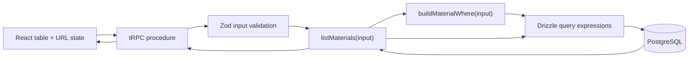
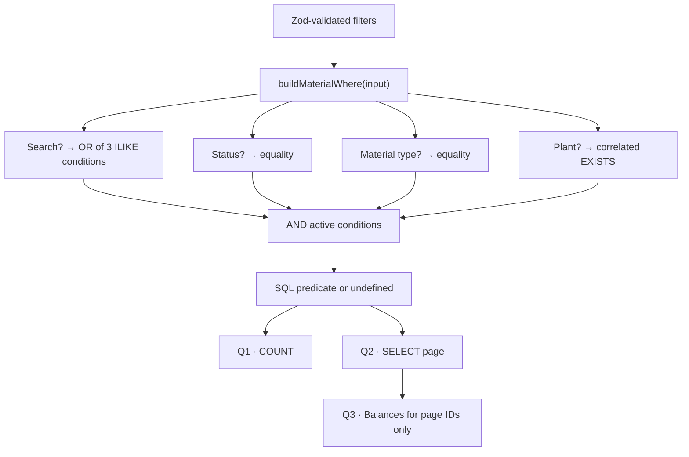
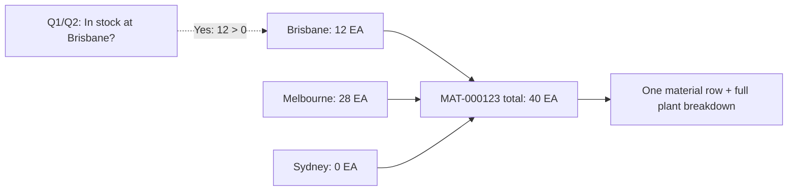

# Material Register query and database operations plan

**Lexin AI Assessment · The Pragmatist**

Implement the register's database-backed operations in **Node/TypeScript using Drizzle ORM and PostgreSQL**. The core is `materials.list`: one reusable TypeScript `WHERE` builder supports search and filters, while three small database queries handle the matched count, material page, and plant balances. Editing is a separately scoped optional extension.

This plan extends `material-register-app-architecture.md` and `db-schema-architecture-plan.md`; the rationale and deferred considerations are recorded in `scratchpad.md`. The source of assessment requirements is `3b-takehome-the-pragmatist.docx`.

## Responsibilities and request flow

| Layer | Responsibility |
| --- | --- |
| **React + nuqs** | Hold search, filter, sort and page state in the URL; debounce requests for text search. |
| **TanStack Query + tRPC client** | Request and cache the matching register page; manage loading and error states. |
| **tRPC + Zod** | Validate inputs and expose a typed API contract. |
| **TypeScript query functions** | Construct reusable predicates, choose allowed sorts, execute the three Drizzle queries, and assemble response rows. |
| **Drizzle ORM** | Map the schema to typed column expressions; parameterise inputs; build `SELECT`, `EXISTS`, `COUNT`, `ORDER BY`, `LIMIT/OFFSET`, joins and SQL expressions. |
| **PostgreSQL** | Perform the actual matching, sorting, pagination, counting and stock aggregation. |



**Terminology:** `listMaterials()` and `buildMaterialWhere()` are **TypeScript functions**, not PostgreSQL stored functions. The latter only constructs a SQL condition; it does not contact the database. Drizzle translates the expressions into parameterised PostgreSQL SQL. [Drizzle conditional filters](https://orm.drizzle.team/docs/guides/conditional-filters-in-query) · [Drizzle filter operators](https://orm.drizzle.team/docs/operators)

## Procedure contracts and scope

| tRPC procedure | TypeScript/database operation | Status |
| --- | --- | --- |
| `materials.list` | `listMaterials(input)` → three queries, returning rows and matched total | **Core** |
| `plants.list` | `listPlants()` → plant codes and names for the dropdown | **Core** |
| `materials.byNumber` | `getMaterialByNumber(number)` → one material and its plant balances | **Optional detail view** |
| `materials.update` | `updateMaterial(number, changes)` → validated partial `UPDATE … RETURNING` | **Optional edit view** |

**Suggested `materials.list` input:** `search?`, `status?`, `materialType?`, `plantCode?`, `sortBy`, `sortDirection`, `page` and `pageSize`. Zod validates all enum values and the sort allowlist; suggested defaults are page `1`, page size `25` (maximum `100`), sort `updatedAt DESC`. Defaults and numeric bounds are implementation choices, not assessment requirements.

**Suggested output:** `{ rows, total, page, pageSize }`. Each row contains its catalogue fields, `totalQuantityOnHand` (decimal string) and `plantBalances` (all plants carrying that material, including zero balances). A missing balance set means total `"0"`. Keep price and stock quantities as decimal strings at the API boundary to avoid precision loss; serialise `updatedAt` consistently (for example, as an ISO-8601 string).

## Search and filter contract

| Input | PostgreSQL condition | Notes |
| --- | --- | --- |
| `search` | `material_number ILIKE pattern OR description ILIKE pattern OR manufacturer_part_number ILIKE pattern` | Trim whitespace; escape literal `%`, `_` and `\` before adding substring wildcards. |
| `status` | `materials.status = value` | Catalogue lifecycle; not inferred from stock. |
| `materialType` | `materials.material_type = value` | Proposed third core filter; values come from the defined enum. |
| `plantCode` | `EXISTS (SELECT 1 FROM plant_catalogue … quantity_on_hand > 0)` | UI label: **In stock at**. Match plant **code**, not display name. |
| `manufacturerName` | Exact manufacturer-name predicate | **Deferred / open.** Would support the full SKF scenario; not part of the confirmed core input. |

The **three search fields form one `OR` group**. Every other active filter combines with that group using `AND`. Omitted filters add no predicate. A correlated `EXISTS` checks plant availability without duplicating material rows. [PostgreSQL pattern matching](https://www.postgresql.org/docs/current/functions-matching.html) · [PostgreSQL `EXISTS`](https://www.postgresql.org/docs/current/functions-subquery.html#FUNCTIONS-SUBQUERY-EXISTS)

### TypeScript `WHERE` builder



Implementation sketch, using **illustrative property and file names** that should be reconciled with the final Drizzle schema:

```ts
import { and, eq, exists, gt, ilike, or, type SQL } from 'drizzle-orm';
import { db } from '../client';
import { materials, plantCatalogue } from '../schema';
import type { ListMaterialsInput } from '../../trpc/schemas/materials';

// PostgreSQL LIKE/ILIKE: escape %, _ and the backslash escape character.
const escapeLike = (value: string) =>
  value.replace(/[\\%_]/g, (character) => `\\${character}`);

export function buildMaterialWhere(input: ListMaterialsInput): SQL | undefined {
  const predicates: SQL[] = [];
  const search = input.search?.trim();

  if (search) {
    const pattern = `%${escapeLike(search)}%`;
    const textMatch = or(
      ilike(materials.materialNumber, pattern),
      ilike(materials.description, pattern),
      ilike(materials.manufacturerPartNumber, pattern),
    );
    if (textMatch) predicates.push(textMatch);
  }
  if (input.status) predicates.push(eq(materials.status, input.status));
  if (input.materialType) predicates.push(eq(materials.materialType, input.materialType));
  if (input.plantCode) {
    predicates.push(exists(
      db.select({ materialNumber: plantCatalogue.materialNumber })
        .from(plantCatalogue)
        .where(and(
          eq(plantCatalogue.materialNumber, materials.materialNumber),
          eq(plantCatalogue.plantCode, input.plantCode),
          gt(plantCatalogue.quantityOnHand, '0'),
        )),
    ));
  }
  return and(...predicates); // undefined when there are no predicates
}
```

The inner `db.select()` **builds a subquery expression; it is not awaited or executed inside the helper**. The helper returns a reusable `SQL | undefined` predicate. Drizzle binds user-supplied values as parameters; input strings must never be interpolated into SQL source text. [Drizzle conditional filters](https://orm.drizzle.team/docs/guides/conditional-filters-in-query) · [Drizzle operators and parameterisation](https://orm.drizzle.team/docs/operators)

## `materials.list` — agreed three-query design

```mermaid
sequenceDiagram
    participant API as listMaterials()
    participant DB as PostgreSQL
    API->>API: Validate input; build WHERE once
    API->>DB: Q1 COUNT matched materials (WHERE)
    DB-->>API: total
    API->>DB: Q2 SELECT material page (same WHERE, ORDER, LIMIT/OFFSET)
    DB-->>API: pageRows
    alt pageRows is not empty
        API->>DB: Q3 SELECT ALL plant balances WHERE material_number IN page IDs
        DB-->>API: balances + windowed totals
    end
    API->>API: Group balances by material; preserve Q2 row order
    API-->>API: Return {rows, total, page, pageSize}
```

| Query | Drizzle / PostgreSQL operation | Key rule |
| --- | --- | --- |
| **Q1 · Count** | `select({ total: count() }).from(materials).where(where)` | Count **materials**, not stock rows; never apply `LIMIT/OFFSET`. |
| **Q2 · Material page** | `select({...}).from(materials).where(where).orderBy(...).limit(...).offset(...)` | Allow `materialNumber` and `updatedAt` sorting. Always enforce unique ordering: for timestamp sorting, append `materialNumber ASC` as tie-breaker. |
| **Q3 · Stock and totals** | `select(...)` from `plant_catalogue`, join `plants`, filter with `inArray(materialNumber, pageIds)`; `SUM(quantity_on_hand) OVER (PARTITION BY material_number)` | **Do not reuse Q1/Q2's plant filter.** Include every balance for each returned material, including zero-quantity rows. Skip Q3 for an empty page. |

Q3 returns one record per material–plant balance with its corresponding all-plant total repeated on each balance row. Group in TypeScript by material number and attach to the Q2 results **without changing Q2 ordering**. Default to `"0"` and `[]` for materials with no balance rows. The database performs the aggregation, not the browser. [Drizzle SELECT](https://orm.drizzle.team/docs/select) · [Drizzle count](https://orm.drizzle.team/docs/guides/count-rows) · [PostgreSQL window functions](https://www.postgresql.org/docs/current/functions-window.html) · [PostgreSQL LIMIT/OFFSET](https://www.postgresql.org/docs/current/queries-limit.html)

### Why the plant filter must not constrain Q3



**Example:** “In stock at Brisbane” selects a material with Brisbane `12 EA`; the expanded row displays **40 EA** from Brisbane `12` + Melbourne `28` + Sydney `0`. A zero balance is included in the expansion; no balance row means the plant does not carry the material. A material with no balances has total `0`.

### Other supporting operations

- **`plants.list` (core):** select and order `plant_code`, `name` (optionally city/state). No join or pagination is needed for the small plant list.
- **`materials.byNumber` (optional):** fetch the material by its primary key and its full plant balances. Return `NOT_FOUND` if absent. Reuse the same decimal and balance representation as the register.
- **`materials.update` (optional):** Zod accepts a **nonempty** partial update to description, material type, lifecycle status, manufacturer name, manufacturer part number, or AUD unit price. Unknown keys are rejected; omitted fields remain unchanged; `null` clears allowed nullable fields. Use one Drizzle `update(materials)` call with `.set()`, `.where()` on material number and `.returning()`; set `updated_at` to PostgreSQL `now()`. Return `NOT_FOUND` on an empty return, then invalidate affected list and detail queries. Material number, base unit and plant balances remain read-only in this form. [Drizzle UPDATE / RETURNING](https://orm.drizzle.team/docs/update)

Optional editing is **not required by the brief**. It is one possible extra if the complete register is already working; do not expand it into stock mutation or audit history within assessment scope.

## Implementation sequence

1. **Align schema and types.** Import the three agreed Drizzle tables and enum values. Define a Zod input schema for list filters, sort allowlist, and bounded pagination; infer its TypeScript type. Use explicit response projections instead of returning whole DB rows.
2. **Implement `buildMaterialWhere()`.** Implement the three-field `ILIKE` group, status/type equality, and correlated plant `EXISTS`. Add literal wildcard escaping. Check no-filter behaviour and combined predicates.
3. **Implement Q1 and Q2 in `listMaterials()`.** Reuse one built predicate; add `count()`, sort allowlist, deterministic tie-breaker, `LIMIT` and `OFFSET`. Ensure an out-of-range page returns `rows: []` **and the true count**.
4. **Implement Q3.** Query stock balances for Q2 material IDs in one batch, join plant labels, calculate windowed totals, and group by material number in TypeScript. Skip Q3 on empty pages.
5. **Expose procedures.** Wire `materials.list` and `plants.list` through tRPC. Keep Express as the existing tRPC host; connect the frontend through the agreed same-origin proxy.
6. **Verify with the seeded PostgreSQL database.** Exercise the combined filters, shared materials, depleted plants, wildcard characters, timestamp ties, paging and API input rejection. Check the register against an independently computed stock sum.
7. **Only if the core is complete:** implement the optional `materials.byNumber` and `materials.update`, including validation and TanStack Query invalidation.

Suggested module boundaries (adapt to the actual repository layout):

```text
api/src/db/schema.ts                 # Drizzle tables and PostgreSQL enums
api/src/db/queries/material-where.ts # buildMaterialWhere (SQL expression only)
api/src/db/queries/materials.ts      # Q1, Q2, Q3; optional detail/edit
api/src/db/queries/plants.ts         # listPlants
api/src/trpc/schemas/materials.ts    # Zod list and optional edit inputs
api/src/trpc/routers/materials.ts    # tRPC procedures
api/src/trpc/routers/plants.ts       # tRPC procedure
```

## Verification checklist

| Case | Expected behaviour |
| --- | --- |
| No filters | All materials eligible; Q1 returns total; Q2 returns a stable first page. |
| Text + status + plant combined | Predicates combine with `AND`, search columns with `OR`; matching material appears once. |
| Active material with zero stock | Still active; excluded only if positive plant availability is required. |
| Material stocked at multiple plants | Appears once, contributes once to total count, displays all-plant quantity. |
| Plant balance exactly zero | Fails `In stock at` for that plant, but appears in expansion if material matches otherwise. |
| Search for `%`, `_` or `\` | Characters are treated literally, not as pattern operators. |
| Equal `updated_at` values | Material-number tie-breaker gives reproducible pages. |
| Page beyond final page | Empty rows; correct matched total; Q3 not executed. |
| Invalid enum, sort or page size | Zod rejects input before SQL execution. |
| Optional edit changes filter membership | Detail and register queries refetch; URL state remains unchanged. |

## Other options considered and trade-offs

**Decision: keep three queries.** This prioritises a transparent implementation and straightforward filter changes for the live interview; it is **not** a claim that three queries are fastest.

| Approach | Benefit | Trade-off / decision |
| --- | --- | --- |
| **A — Three queries (selected)** | Simple Q1 count, Q2 page and Q3 batched balances; directly readable Drizzle queries; shared predicate easily extended. | Three round trips on nonempty pages; TypeScript groups balances. **Selected.** |
| **B — Two queries using `LEFT JOIN LATERAL` + `JSONB_AGG`** | Combines the material page and each material's stock breakdown; one fewer round trip; page and balances from one statement snapshot. | More PostgreSQL-specific SQL and JSON typing; lateral lookups may or may not outperform batching. **Deferred.** [PostgreSQL LATERAL](https://www.postgresql.org/docs/current/queries-table-expressions.html#QUERIES-LATERAL) |
| **C — One SQL statement with CTEs** | Single round trip and one statement-level snapshot. | More complex result shaping, particularly a correct count when the requested page is empty. **Deferred.** [PostgreSQL WITH](https://www.postgresql.org/docs/current/queries-with.html) |
| **D — PostgreSQL stored function** | Database-side reusable API for multiple consumers. | Additional SQL interface and versioning alongside the existing Drizzle/tRPC layer. **Not selected.** [PostgreSQL CREATE FUNCTION](https://www.postgresql.org/docs/current/sql-createfunction.html) |
| **Join `plant_catalogue` into the material page before pagination** | Can look like a single straightforward query. | Multiplies material rows and risks incorrect counts/pages without grouping. **Rejected for the register page.** |

### Scale and consistency considerations — deferred

- **Snapshot consistency:** under default PostgreSQL `READ COMMITTED`, Q1, Q2 and Q3 may observe different committed snapshots during concurrent edits. A short read-only `REPEATABLE READ` transaction is a later option; not needed for the initial assessment. [PostgreSQL isolation](https://www.postgresql.org/docs/current/transaction-iso.html)
- **Indexing:** retain the schema's primary keys and plant-code index. Examine real `EXPLAIN (ANALYZE, BUFFERS)` plans before adding indexes for sorting or `ILIKE` searches. Trigram search indexing is separately identified as an optional extra in the brief. [PostgreSQL EXPLAIN](https://www.postgresql.org/docs/current/using-explain.html) · [pg_trgm](https://www.postgresql.org/docs/current/pgtrgm.html)
- **Large offsets:** `OFFSET` is acceptable for a 5,000-record assessment. Cursor pagination can be revisited at larger scale or for deep-page performance. [PostgreSQL LIMIT/OFFSET](https://www.postgresql.org/docs/current/queries-limit.html)
- **Concurrent editing (optional feature):** initially update submitted fields by material number, accepting that two committed changes to the same field leave the later database value. For multi-user scale, consider optimistic concurrency with an incrementing row version and a conflict response. [PostgreSQL Read Committed](https://www.postgresql.org/docs/current/transaction-iso.html#XACT-READ-COMMITTED)
- **AI-assisted maintenance:** a future deterministic skill for “add filter” should update Zod, the `WHERE` builder, the nuqs URL parser, the Mantine control and affected tests. Q1/Q2 should not need restructuring, and Q3 should remain unchanged.

## References

- **Assessment:** `3b-takehome-the-pragmatist.docx` (required register behaviour, 5,000 records, optional extras and live-change expectations).
- **Internal plans:** `material-register-app-architecture.md` (stack and request flow); `db-schema-architecture-plan.md` (tables, stock semantics, seed); `scratchpad.md` (decisions, scope and alternatives).
- **Drizzle:** [Conditional filters](https://orm.drizzle.team/docs/guides/conditional-filters-in-query) · [Operators and parameterisation](https://orm.drizzle.team/docs/operators) · [SELECT, sorting and pagination](https://orm.drizzle.team/docs/select) · [Count rows](https://orm.drizzle.team/docs/guides/count-rows) · [UPDATE / RETURNING](https://orm.drizzle.team/docs/update).
- **PostgreSQL:** [Pattern matching](https://www.postgresql.org/docs/current/functions-matching.html) · [`EXISTS`](https://www.postgresql.org/docs/current/functions-subquery.html#FUNCTIONS-SUBQUERY-EXISTS) · [Window functions](https://www.postgresql.org/docs/current/functions-window.html) · [LIMIT/OFFSET](https://www.postgresql.org/docs/current/queries-limit.html) · [Transaction isolation](https://www.postgresql.org/docs/current/transaction-iso.html) · [EXPLAIN](https://www.postgresql.org/docs/current/using-explain.html).
