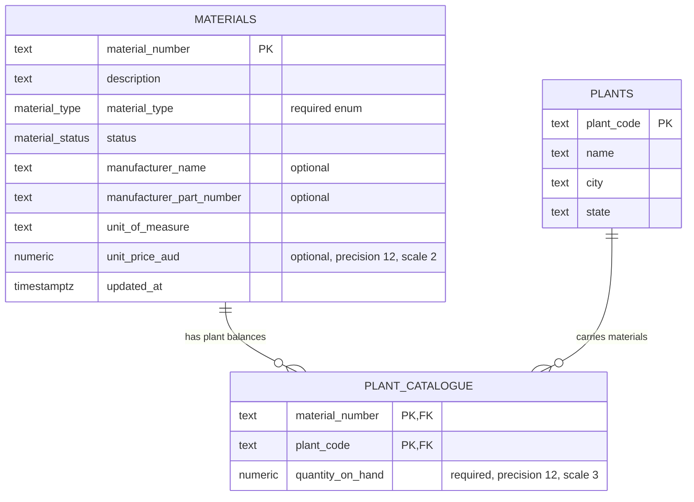
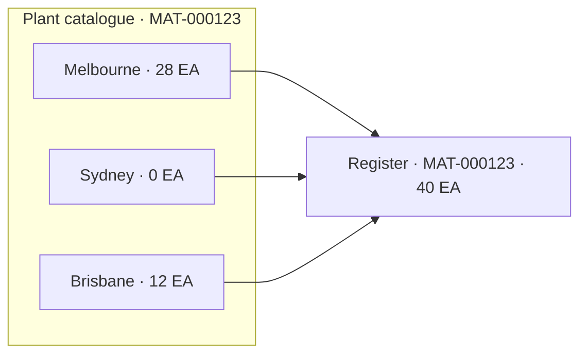

# Material Register database architecture

**Lexin AI Assessment · The Pragmatist**

Store one record per material and one stock balance per material–plant pair. The register shows one row per material with the total quantity on hand. Expanding a row shows the balance at each plant that carries the material. Manufacturer name and part number live on the material record.

## Schema and relationships

| Table | Responsibility |
| --- | --- |
| `materials` | One row per material number. Owns the description, type, lifecycle status, manufacturer details, base unit, unit price and catalogue update time. |
| `plants` | One row per site. Owns the plant code, site name, city and state. |
| `plant_catalogue` | One row per material–plant pair. Owns the quantity on hand at that plant, expressed in the material’s base unit. |

- **Keys and indexes.** Use text identifiers to preserve prefixes and leading zeroes. The composite primary key `(material_number, plant_code)` prevents duplicate balances and supports lookups by material number. Add a B-tree index on `plant_catalogue.plant_code` for plant-first lookups. [PostgreSQL constraints](https://www.postgresql.org/docs/current/ddl-constraints.html) · [Multicolumn indexes](https://www.postgresql.org/docs/current/indexes-multicolumn.html)
- **Material type.** Define the PostgreSQL enum `material_type` with Drizzle’s `pgEnum`. Its exact values are `Spare Part`, `Consumable`, `Raw Material` and `Tool`. Declare `materials.material_type` as `NOT NULL` so each material has a valid type. PostgreSQL enforces the set for every write. Adding a type requires a schema migration. [PostgreSQL enums](https://www.postgresql.org/docs/current/datatype-enum.html) · [Drizzle `pgEnum`](https://orm.drizzle.team/docs/column-types#enum)
- **Lifecycle and update time.** Use a PostgreSQL enum for lifecycle status (Active, Pending Review, Obsolete). A material can be Active with zero stock. `updated_at` records the last update to the material’s catalogue details.
- **Quantities and price.** Require a non-negative quantity. Use exact decimals for stock and price so the schema accommodates units such as `KG` and cent-precision AUD prices. An optional price can be absent or non-negative. [PostgreSQL numeric types](https://www.postgresql.org/docs/current/datatype-numeric.html)

## Price storage and precision

Store `unit_price_aud` as PostgreSQL `numeric(12,2)` and use Drizzle’s default string mapping in TypeScript and the API. A price such as `19.95` remains an exact decimal in the database for numeric sorting, filtering and aggregation. The API returns `"19.95"`, which can go directly into `decimal.js` if TypeScript later needs to calculate prices. This uses the existing stack. [PostgreSQL numeric types](https://www.postgresql.org/docs/current/datatype-numeric.html) · [Drizzle numeric mapping](https://github.com/drizzle-team/drizzle-orm/blob/main/drizzle-orm/src/pg-core/columns/numeric.ts) · [Decimal.js API](https://mikemcl.github.io/decimal.js/)

Two decimal places fit the catalogue’s AUD unit prices. Adding and subtracting cent amounts preserves cent precision. Allocating a batch price, applying a percentage discount or pricing a fractional quantity can produce sub-cent amounts. For example, a $100 contract for 30 units implies $3.333… per unit. Rounding the unit price to $3.33 first gives $99.90 when multiplied back. Preserve the agreed batch amount and use the required precision through the calculation, with rounding at the line or invoice step specified by the pricing rule.

## How stock appears in the register

A stock row with quantity `0` means the plant carries the material and is currently depleted. An absent stock row means the plant is outside that material’s assortment. Calculate the all-plant total with `SUM(quantity_on_hand)` and return zero when a material has no stock rows. [PostgreSQL aggregate functions](https://www.postgresql.org/docs/current/functions-aggregate.html)

1. **Match materials.** Use parameterised `ILIKE` substring matching on material number, description and manufacturer part number. Escape wildcard characters in the search term to match them literally. Combine the search with lifecycle status and plant filters. A plant filter labelled **In stock at** uses `EXISTS` for a balance greater than zero at the selected plant. [PostgreSQL pattern matching](https://www.postgresql.org/docs/current/functions-matching.html) · [Subquery expressions](https://www.postgresql.org/docs/current/functions-subquery.html)
2. **Count and page materials.** Reuse the same predicates for the total count and page query. Sort by material number or last updated, using material number to break timestamp ties before applying `LIMIT` and `OFFSET`. [PostgreSQL pagination](https://www.postgresql.org/docs/current/queries-limit.html)
3. **Load balances for the page.** Return the manufacturer in the main table, the all-plant total beside the unit, and the plant balances in the expanded row. Fetch balances for the page together. The selected plant controls which materials appear. In the example, filtering for Brisbane still shows **40 EA** as the all-plant total and **12 EA** as Brisbane’s balance.

## Seed data

| Plant | Relative catalogue size | Role in the fictional dataset |
| --- | ---: | --- |
| Melbourne, VIC | 35% | Largest assortment and southern import hub |
| Sydney, NSW | 30% | Second import hub and replenishment point for Brisbane |
| Brisbane, QLD | 25% | Queensland site with some direct imports |
| Perth, WA | 10% | Smaller assortment with a supply route through Fremantle |

Use these percentages as approximate weights for plant catalogue rows. Seed **5,000 distinct materials**, each carried by at least one plant. Let some material numbers appear at multiple sites and vary quantities independently of the number of lines a plant carries. Include realistic product families, shared parts, zero balances and enough active Brisbane bearings to exercise several result pages. Use a deterministic seed and insert all three tables in dependency order within one transaction. Use fixed keys and skip existing keys on reruns.

The warehouse roles and percentages are scenario assumptions. Port of Melbourne throughput and OOCL’s published routes support the choice of plausible gateways, including direct links from Asia to Fremantle. Shipment costs depend on the origin, carrier and onward delivery. [Port of Melbourne FY26 trade report](https://www.portofmelbourne.com/port-of-melbourne-report-victorias-economy-shifts-gears-as-trade-hits-new-record/) · [OOCL Australia service routes](https://www.oocl.com/australia/eng/localinformation/serviceprofile/Pages/default.aspx)

## Implementation order

1. **Define the schema.** Write the three Drizzle table definitions and generate and review the initial SQL migration. [Drizzle Kit generate](https://orm.drizzle.team/docs/drizzle-kit-generate)
2. **Migrate and seed.** Wait for PostgreSQL readiness, apply the migration and run the seed from the API container. Document the commands for a fresh volume. [Docker Compose startup order](https://docs.docker.com/compose/how-tos/startup-order/) · [Drizzle Kit migrate](https://orm.drizzle.team/docs/drizzle-kit-migrate)
3. **Verify the model.** Check that a second seed run leaves counts stable, PostgreSQL rejects a missing or invalid material type and duplicate material–plant pairs, and a shared material appears once in the register. Verify that the plant filter excludes depleted balances, the expanded row includes them, and the total still covers all plants.

## Pros and cons of the selected schema

| Choice | Pros | Cons and trade-offs |
| --- | --- | --- |
| **One balance per material–plant pair** | A planner can find the same part at another site if the local plant is depleted. SAP similarly distinguishes general material data from plant-specific stock. [SAP material master data](https://help.sap.com/docs/SAP_S4HANA_ON-PREMISE/7b24a64d9d0941bda1afa753263d9e39/078bc95360267214e10000000a174cb4.html) · [SAP plant stock](https://help.sap.com/docs/SAP_S4HANA_ON-PREMISE/91b21005dded4984bcccf4a69ae1300c/979ebe532789b44ce10000000a174cb4.html) | Adds a join for the breakdown and requires a material-level page and count. |
| **Manufacturer fields on the material** | Keeps display and part-number search on the material record. A shared set of seed templates keeps names consistent. | Manufacturer names repeat. Renames across the catalogue require updating multiple material records. |
| **Calculated total and separate lifecycle status** | Every total comes from the current plant balances. An active part can be out of stock and remain searchable. | The total requires an aggregate. A low-stock indicator would also require an explicit threshold in the material’s unit of measure. |

## Alternatives discussed

| Alternative | Upside | Trade-off for this assessment |
| --- | --- | --- |
| **Plant foreign key and quantity on `materials`** | The brief’s suggested starting point gives a two-table model with a direct plant filter. | Each material belongs to one plant. The shared-part scenario needs several independent plant balances. |
| **Separate `manufacturers` table** | One canonical record can hold a manufacturer code, display name and other shared attributes. | A fourth table and join serve a small display and search requirement. The assessment needs a name and a part number. |
| **Store the total on `materials`** | The register could read the total directly. | Every balance update would also need to update the total consistently. Calculating it from the balances keeps one source for stock quantities. |
| **Store prices as PostgreSQL `text`** | Passes a decimal string directly to TypeScript. | Numeric ordering, range filters, checks and arithmetic would need casts or extra validation. Drizzle’s default mapping already provides strings with a numeric database column. [PostgreSQL numeric types](https://www.postgresql.org/docs/current/datatype-numeric.html) · [Drizzle numeric mapping](https://github.com/drizzle-team/drizzle-orm/blob/main/drizzle-orm/src/pg-core/columns/numeric.ts) |
| **Use a higher price scale up front** | Preserves fractional cents in stored unit prices. | The catalogue uses cent-denominated prices. Increase the scale before importing fractional-cent unit prices if a supplier contract requires them. PostgreSQL rounds incoming values to the declared scale. [PostgreSQL numeric types](https://www.postgresql.org/docs/current/datatype-numeric.html) |
| **Add `decimal.js` now** | Provides decimal arithmetic and configurable rounding in TypeScript. | The register displays prices. Add the dependency when a TypeScript pricing calculation needs it and define the rounding rule for that calculation. [Decimal.js API](https://mikemcl.github.io/decimal.js/) |

## References

- **3b-takehome-the-pragmatist.docx**, supplied assessment brief. Source for the minimum schema, realistic seed size, list behaviour and optional detail view.
- The links in each section document SAP’s material and stock model, PostgreSQL behaviour, migration tooling and Australian shipping context. Schema scope, filter semantics and seed weights are project decisions.
