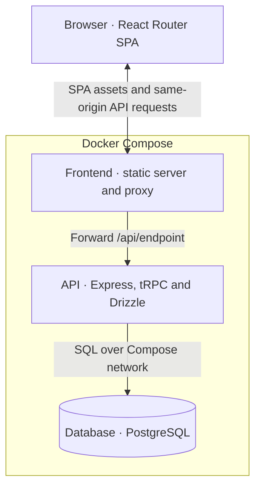
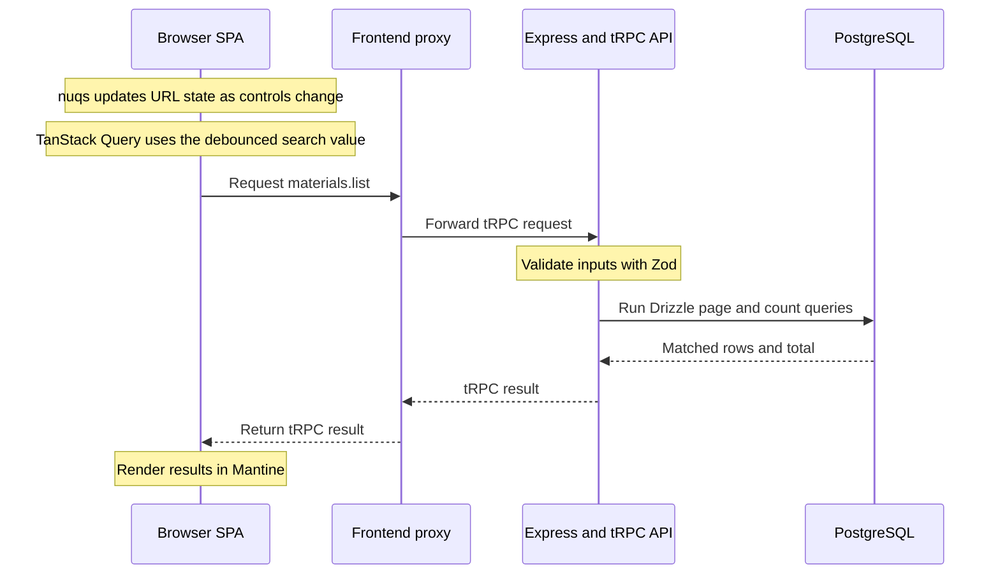

# Material Register architecture plan

**Lexin AI Assessment · The Pragmatist**

Build a React Router v7 **Data Mode** SPA for searching and browsing material records. The core scope is case-insensitive search across material number, description and manufacturer part number, at least two combinable filters, sorting on at least two columns, and server-side pagination. The table has loading, empty and error states. Its view can be restored from a shared URL. [UI implementation plan](ui-implementation-plan.md)

## Stack and deployment

| Location | Stack and responsibility |
| --- | --- |
| Browser | **React, TypeScript, React Router v7 Data Mode, nuqs, TanStack Query, Mantine and Mantine DataTable.** React Router handles navigation through route objects. nuqs reads and writes typed URL state, TanStack Query fetches and caches API results, and Mantine and Mantine DataTable render the controls and table. |
| Frontend container | **Static web server.** Serves the Vite-built SPA, supports direct navigation to client routes through the SPA fallback, and proxies to the API container. |
| API container | **Node.js, TypeScript, Express, tRPC, Zod and Drizzle.** Express mounts the tRPC adapter, Zod validates procedure inputs, and Drizzle owns the schema, migrations and SQL queries. |
| Database container | **PostgreSQL.** Stores the materials and related records in a named volume. Executes the search, filters, sorting and pagination. |

Only the frontend port needs to be published for the app. The browser uses a relative API URL. The frontend proxy creates the same-origin request path, and the Compose network carries traffic between containers by service name.

## How a table request works

1. **React Router v7 Data Mode and nuqs.** Configure `/` and `/materials` with `createBrowserRouter`. The root layout places the v7 nuqs adapter around `Outlet`. The URL holds search text, filters, sort and page. One `useQueryStates` definition supplies typed values and defaults, and search, filter or sort changes reset the page in the same update.
2. **TanStack Query and tRPC.** The materials route mounts the toolbar and starts independent `materials.list` and `plants.list` reads through the typed tRPC client. Debounce the search value passed to the list query using Mantine’s `useDebouncedValue`. Pause the list query while the search term is settling so a page reset cannot trigger a request with the previous term.
3. **Express and Zod.** Express forwards requests to the tRPC router. The `materials.list` procedure validates its input with Zod, including allowed filter values, sort keys and pagination bounds. The browser imports the tRPC router’s type only.
4. **Drizzle and PostgreSQL.** Build one predicate for the count and material page, using `EXISTS` for positive stock at a selected plant. Apply a stable sort and paginate materials, then fetch their plant balances and labels in Q3. Return the rows and total to the SPA. Drizzle infers the projected row shape and tRPC carries the procedure input and output types to the client.

## Implementation order

1. **Database and startup.** Define the material and related tables with a foreign key. Write migrations and a repeatable seed for at least 5,000 realistic materials. Configure Compose with a PostgreSQL readiness check and document how to migrate and seed a fresh database.
2. **API.** Build `materials.list` with the Zod input schema, case-insensitive search, combined filters, an allowlist of sort columns, and page/count queries. Exercise valid and invalid inputs before wiring the table.
3. **Frontend.** Mount the Data Mode router, the nuqs adapter in its root layout and the tRPC/TanStack Query providers. Render the controls and returned page in Mantine DataTable. Check that a copied URL restores the view and clearing filters returns the user to page one.
4. **Reviewer run-through.** Follow the README from a fresh database volume. Check combined search and filters, stable pagination, direct URL loads, and loading, empty and error states. Walk through adding a filter from URL state to the Zod schema and Drizzle query.

## Pros and cons of the selected stack

| Choice | Pros | Cons and trade-offs |
| --- | --- | --- |
| **Three Compose services and same-origin proxy** | Clear separation between the frontend, API and database. One browser origin keeps the request path simple. | A separate frontend image and proxy configuration add setup. Database readiness, migration order and the SPA fallback need attention. |
| **Express + tRPC** | Familiar Node HTTP host, inferred TypeScript client contract and a direct TanStack Query integration. Express can host ordinary HTTP routes or middleware if needed. | Express adds a layer to a tRPC-only service. The typed client is coupled to the server router’s TypeScript contract, and REST is easier to call using general-purpose HTTP tools. |
| **Zod + Drizzle** | Zod validates the list operation at runtime. Drizzle keeps queries close to SQL and infers the shape of selected fields and joins. | The list input needs its own rules for search, sorting and pagination. Schema-derived validators are most useful when a payload closely matches a table shape. Joins, indexes and predictable sorting still need deliberate design. |
| **React Router v7 Data Mode + nuqs** | Route objects make the route structure explicit. Grouped, typed URL state supports shareable views and keeps controls and URLs in sync. | The root route supplies the nuqs adapter and outlet. TanStack Query owns the register requests and their feedback states. |
| **TanStack Query** | Handles server-data caching, request states and refetching. tRPC supplies the typed query options. | The app still chooses freshness, retries and how to debounce search-driven requests. |
| **Mantine DataTable and Mantine controls** | Ready-styled controls, sortable headers and built-in expandable rows. | The app connects controls to URL state and renders the specified pagination row. |

## Alternatives discussed

| Alternative | Upside | Trade-off for this assessment |
| --- | --- | --- |
| **Express serving the SPA and API** | Two services with PostgreSQL separate. Fewer images and proxy settings. | Frontend asset serving and API hosting share one app container and entry point. |
| **Standalone tRPC on Node** | Smaller API entry point that keeps the same typed contract and fits the three-container layout. Suitable for local development and a deployed Node service. | Express provides a familiar place for ordinary routes or middleware if the API grows. The selected host for this plan is Express. |
| **Express + REST** | A route like `GET /api/materials` is easy to inspect and test with `curl`. REST satisfies the brief. | The client needs a maintained request/response contract and a typed fetch wrapper. |
| **Hono + typed client** | Conventional HTTP routes with request and response types inferred by Hono’s client. | Runs on Node through Hono’s adapter and uses its typed-route conventions. |
| **Fastify** | A Node HTTP framework with route-level validation and type providers. | The route types still need a client-facing contract. Zod and TypeBox each have their own integration setup. |
| **Elysia + Eden** | Concise route schemas and an inferred TypeScript client. | Node requires an adapter. The assessment already calls for Node, which can be adapted to EysiaJS but the main benefits of EysiaJS come from runing on bun. Express is also a well know ecosystem making maintentace easier for future developers. |
| **TypeBox or Valibot** | TypeBox is a natural fit for JSON Schema-oriented tooling. Valibot offers a modular validation API. Drizzle documents integrations for both. | Each is workable, and the list operation still needs its own input rules. Zod is the agreed validator for the tRPC procedures. |
| **React Router URL handling alone** | `useSearchParams` can cover the requirements with a small parser. | Grouped updates, parsing, serialization and defaults become application code. nuqs covers those jobs for the URL-backed controls. |
| **React Router Declarative Mode** | A compact JSX route tree for this SPA. | Data Mode was chosen because route objects make the configuration easier for the implementer to follow. |
| **React Router Framework Mode or register loaders** | Framework Mode supplies build and route module conventions. Route loaders support data needed before render. | Keep the Vite SPA and route-object setup. The register uses TanStack Query for its debounced list and independent plant lookup. |
| **TanStack Table** | Headless column definitions and table-state utilities, with support for server-driven data. | It adds a headless table model alongside the URL and API state. Mantine DataTable covers the agreed register rendering and expansion. |
| **shadcn/ui + Tailwind CSS** | Customisable component source and styling control. | The standard setup adds Tailwind, and the Data Table guide composes its UI with TanStack Table. Mantine supplies the styled controls and table in one library. |

The static server, package versions, debounce interval, browser-history policy, and exact startup commands are choices for implementation.

## References

- Assessment requirements from the supplied **3b-takehome-the-pragmatist.docx**.
- Deployment and routing. [Docker Compose startup order](https://docs.docker.com/compose/how-tos/startup-order/) · [React Router v7 modes](https://reactrouter.com/7.18.5/start/modes) · [Data Mode route configuration](https://reactrouter.com/7.18.5/start/data/routing) · [nuqs React Router adapter](https://nuqs.dev/docs/adapters) · [nuqs grouped updates](https://nuqs.dev/docs/batching) · [nuqs rate-limiting options](https://nuqs.dev/docs/options)
- API and SQL. [tRPC Express adapter](https://trpc.io/docs/server/adapters/express) · [Standalone adapter](https://trpc.io/docs/server/adapters/standalone) · [tRPC input validators](https://trpc.io/docs/server/validators) · [TanStack Query integration](https://trpc.io/docs/client/tanstack-react-query/usage) · [Drizzle select queries](https://orm.drizzle.team/docs/select) · [PostgreSQL pagination](https://www.postgresql.org/docs/current/queries-limit.html)
- UI and alternatives. [Mantine Table](https://mantine.dev/core/table/) · [Mantine debounce hook](https://mantine.dev/hooks/use-debounced-value/) · [shadcn/ui Data Table](https://ui.shadcn.com/docs/components/radix/data-table) · [Hono RPC](https://hono.dev/docs/guides/rpc) · [Fastify type providers](https://fastify.dev/docs/latest/Reference/Type-Providers/) · [Elysia on Node](https://elysiajs.com/integrations/node) · [Drizzle and TypeBox](https://orm.drizzle.team/docs/typebox) · [Drizzle and Valibot](https://orm.drizzle.team/docs/valibot)
